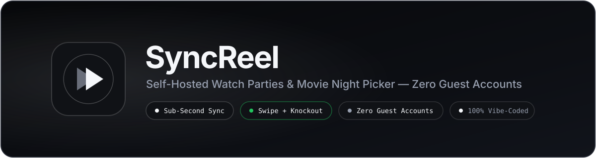
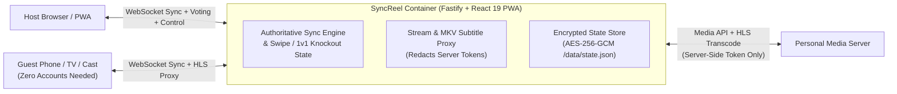

<p align="center">
  
</p>

<p align="center">
  <strong>Self-hosted watch parties and movie-night picking for your personal media server.</strong><br />
  Pick what to watch solo, as a couple on the couch, or across everyone&apos;s phone with <strong>Swipe + 1v1 Knockout</strong> — or send one link to watch together in sub-second sync across browsers, phones, AirPlay, Chromecast, and Smart TVs with <strong>zero guest accounts required</strong>.
</p>

<p align="center">
  <a href="./LICENSE"></a>
  <a href="#-100-ai--vibe-coded-transparency"></a>
  <a href="https://github.com/martion289/syncreel/actions/workflows/ci.yml"></a>
  <a href="https://github.com/martion289/syncreel/releases"></a>
  
  
  
</p>

> [!NOTE]
> **Compatibility & Non-Affiliation:** SyncReel is an independent, open-source, self-hosted project designed to connect to personal **Plex Media Server** instances via their standard API. SyncReel is **not** affiliated with, endorsed by, or sponsored by Plex Inc., and carries an original Silver Screen Minimal UI.

> [!NOTE]
> **Full Transparency — 100% AI / Vibe-Coded:** SyncReel was built from scratch as a **100% AI-generated ("vibe-coded")** open-source project, steered by human product direction, live homelab testing, and automated TypeScript + Vitest verification. See [100% AI / Vibe-Coded Transparency](#-100-ai--vibe-coded-transparency) below.

---

## Why SyncReel?

| Capability | Typical Screen-Share / Legacy Co-Watch | **SyncReel** |
|---|---|---|
| Friends need accounts or paid passes | Often yes | **No** — invite link + display name |
| Standalone "What to Watch?" Picker | Separate tool | **Built-in `/swipe` & subdomain mode** (`Solo`, `Pass Phone`, `Multi-Phone QR`) |
| Deciding when multiple titles match | Pick manually or stop early | **1v1 Knockout Bracket** (with synced Multi-Phone voting + 50/50 coin-flip) |
| Works on mobile & Smart TVs | Inconsistent | **Yes** — installable PWA + HLS + native mobile app deep links |
| Vanity room URLs & QR invites | Rare | **Yes** (`/room/friday-night`) + PIN + scannable QR modal |
| Bandwidth-saving shared transcode | No | **Yes** (Eco Shared Stream mode) |
| Custom subtitle styling & `±ms` offset | Limited | **Yes** (extracts MKV SRT/ASS → WebVTT) |

---

## Features

- **Instant Swipe + 1v1 Knockout Picker (`/swipe` or `swipe.*` subdomain)**:
  - **Instant Swipe Canvas**: Launches straight onto full-bleed poster cards without a wall of forms; tap the pill bar anytime to adjust mode or filters in a slide-up sheet.
  - **By Category OR By Genre**: Swipe curated presets (*Unwatched Gems*, *Award-Worthy `7.8+ ★`*, *Popular Right Now*, *Short & Sweet `<100m`*, *Throwback Classics Pre-2010*, *Comfort Rewatch*, *Wildcard*) or pick a specific genre.
  - **3 Couch / IRL Modes**:
    - **Solo**: Swipe right on titles you'd watch, launch the **1v1 Knockout Bracket** anytime from `2+` likes, and open the winner straight in your native media mobile app (`plex://preplay/`) or web player.
    - **Pass the Phone**: 2–4 couch players take turns secretly swiping the same deck on one phone before entering the 1v1 bracket.
    - **Multi-Phone QR**: Scan a QR code so everyone swipes **and votes live head-to-head on every 1v1 matchup** on their own phones (with automatic majority advance and a 1-tap **50/50 Coin Flip** on 1–1 ties). Even partners sharing a single login automatically get separate seats.
- **Zero-Config Setup Wizard**: Boot the container with zero `.env` configuration. SyncReel auto-generates an encrypted `secret.key` in `/data`, connects your media server via OAuth PIN flow, and probes server connections with live latency checks.
- **Zero-Account Guest Invites & Vanity Rooms**: Generate memorable room URLs like `/room/velvet-cinema` with optional PIN protection, and share via the **Invite Everyone** modal (QR code, Smart TV code, native Share Sheet, WhatsApp, SMS, Telegram, Email, Discord webhook).
- **Sub-Second Authoritative Sync + Buffering Recovery**: NTP-style clock offset estimation pairs with a 3-tier drift controller (deadband under `180ms`, gentle `0.95x–1.05x` rate nudge up to `1500ms`, hard seek above `1500ms`). If any viewer stalls, playback pauses for the room and resumes together.
- **Per-Viewer HLS OR Eco Shared Stream**: Give every viewer independent quality, audio track, and subtitle selection, or toggle **Eco Shared Stream** so the entire room shares a single transcode session.
- **Embedded MKV Subtitles + Custom Styling & Offset**: Extracts embedded SRT/ASS text subtitles to WebVTT on the fly (no video burn-in required), with per-viewer font size, background opacity, and `±5000ms` timing offset controls.
- **Fullscreen Floating Chat & Emoji Overlays**: Incoming chat bubbles and floating emoji reactions render right over fullscreen playback (upper-right frosted glass away from subtitles) alongside an inline Quick Chat bar.
- **AirPlay, Chromecast, PiP & Smart TV Mode**: Native Safari HLS AirPlay, Google Cast Default Receiver sync, Picture-in-Picture, OS Media Session lock-screen controls, installable mobile PWA, and TV remote navigation (`?tv=1`).

---

## Architecture



---

## 60-Second Quick Start (Docker Compose)

1. Save this minimal `docker-compose.yml` (or clone this repo and run directly):

   ```yaml
   services:
     syncreel:
       image: ghcr.io/martion289/syncreel:latest
       # Or build locally from source:
       # build: .
       container_name: syncreel
       restart: unless-stopped
       environment:
         NODE_ENV: production
         PORT: 3000
         DATA_DIR: /data
       ports:
         - "3000:3000"
       volumes:
         - syncreel_data:/data
       # Uncomment on Linux if your media server runs natively on the Docker host:
       # extra_hosts:
       #   - "host.docker.internal:host-gateway"

   volumes:
     syncreel_data:
   ```

2. Start SyncReel:

   ```bash
   docker compose up -d --build
   ```

3. Place SyncReel behind an **HTTPS reverse proxy** (Caddy, Nginx, Traefik, or Cloudflare Tunnel) — see [docs/DEPLOYMENT.md](./docs/DEPLOYMENT.md) and [`deploy/`](./deploy).

   > [!IMPORTANT]
   > HTTPS is required in production for `Secure` session cookies, PWA installation, and Chromecast. On direct proxies (without Cloudflare proxy), disable response buffering (`flush_interval -1` in Caddy, `proxy_buffering off` in Nginx) so `.m3u8` / `.ts` streaming stays smooth.

4. Open `https://your-domain.example` and complete the 3-step **Setup Wizard**. Optionally point a `swipe.your-domain.example` subdomain to the same container to open directly onto the Standalone & IRL Movie Picker.

---

## Configuration & Environment Variables

All environment variables in [`.env.example`](./.env.example) are optional — SyncReel boots cleanly with defaults and persists auth/settings in encrypted storage.

| Variable | Default | Description |
|---|---|---|
| `PORT` | `3000` | HTTP port inside the container or dev server. |
| `PUBLIC_URL` | `""` | Public `https://...` origin used for `Secure` cookies, WebSocket origin checks, and webhook invite links. |
| `PLEX_URL` | `""` | Optional media server URL fallback (normally set in the Setup Wizard). |
| `APP_SECRET` | Auto-generated | 64-char hex secret for AES-256-GCM state encryption & HMAC cookies. Auto-generated to `DATA_DIR/secret.key` if omitted. |
| `DATA_DIR` | `./data` (`/data` in Docker) | Persistent directory for `secret.key` and `state.json`. |
| `CLIENT_IDENTIFIER` | `syncreel-plex-01` | Client identifier reported to your media server API. |
| `CLOUDFLARE_API_TOKEN` | `""` | Optional Cloudflare token (Zone → DNS → Edit) for the optional `--profile ddns` service in `docker-compose.yml`. |

---

## Keyboard & Smart TV Remote Shortcuts

### Video Player
| Key / Remote Button | Action |
|---|---|
| `Space`, `k`, `MediaPlayPause` | Play / Pause |
| `ArrowLeft`, `MediaRewind` | Seek back `10s` |
| `ArrowRight`, `MediaFastForward` | Seek forward `10s` |
| `f` | Toggle fullscreen |
| `m` | Toggle mute |
| `c` | Cycle embedded text subtitle tracks |
| `t` | Show / hide side panel (Chat, Up Next, Room) |
| `Escape` | Close player settings popover |

### Swipe Match & 1v1 Knockout
| Key / Gesture | Action |
|---|---|
| Drag Left / `ArrowLeft` | Pass (`PASS`) or pick Option A in 1v1 |
| Drag Right / `ArrowRight` | Like (`WATCH`) or pick Option B in 1v1 |
| `i` / Info button | Toggle plot synopsis sheet |
| `Escape` | Close Swipe Match modal |

---

## Local Development & Solo Multi-Viewer Testing

### Run Locally

```bash
npm install
npm run build --workspace=@syncreel/shared
npm run dev
```

- **Web UI (Vite)**: `http://localhost:5173` (proxies `/api` and `/ws` to `:3000`)
- **API & WebSocket Server (Fastify)**: `http://localhost:3000`

### Quality & Test Suite

```bash
npm run typecheck   # Type-checks @syncreel/shared, @syncreel/server, and @syncreel/web
npm test            # Runs Vitest unit & security tests across server and web
npm run build       # Compiles shared library, Fastify server, and Vite PWA bundle
```

### Solo Multi-Viewer Testing
You can verify multi-viewer sync, Swipe Match voting, synced 1v1 Knockout tie-breakers, Movie Polls, Host-Only locks, and buffering recovery alone in one browser:
1. Create a screening room as Host in Tab 1.
2. Open the **Room** tab in the sidebar and click **Open Guest Preview Tab** (`/room/:code?asGuest=1`), which runs an isolated guest token in `sessionStorage`.
3. Swipe, vote head-to-head, or trigger **Sim 4s Buffer** in Tab 2 to test multi-user behavior locally.

---

## 🤖 100% AI / Vibe-Coded Transparency

SyncReel was conceived, architected, debugged, and polished **100% through AI-assisted / vibe coding** under human product direction and live homelab verification.

What that means for self-hosters and contributors:
- **Verified Automatically, Still Inspect Before Trusting Blindly**: Every build runs strict TypeScript checks across `@syncreel/shared`, `@syncreel/server`, and `@syncreel/web`, plus Vitest unit and security integration tests (covering sync engine rules, 1v1 knockout bracket progression, SRT/ASS→WebVTT subtitle conversion, playlist token redaction, SSRF webhook blocking, guest isolation, and swipe physics).
- **Community Review Welcome**: While defensive security controls are built in (see [SECURITY.md](./SECURITY.md)), security audits, refactors, issue reports, and pull requests are **always welcome**!

---

## Contributing, Security & License

- **Deployment & Reverse Proxy Guide**: [docs/DEPLOYMENT.md](./docs/DEPLOYMENT.md)
- **Contributing Guide**: [CONTRIBUTING.md](./CONTRIBUTING.md)
- **Security Policy**: [SECURITY.md](./SECURITY.md)
- **Changelog**: [CHANGELOG.md](./CHANGELOG.md)
- **License**: [MIT](./LICENSE)
